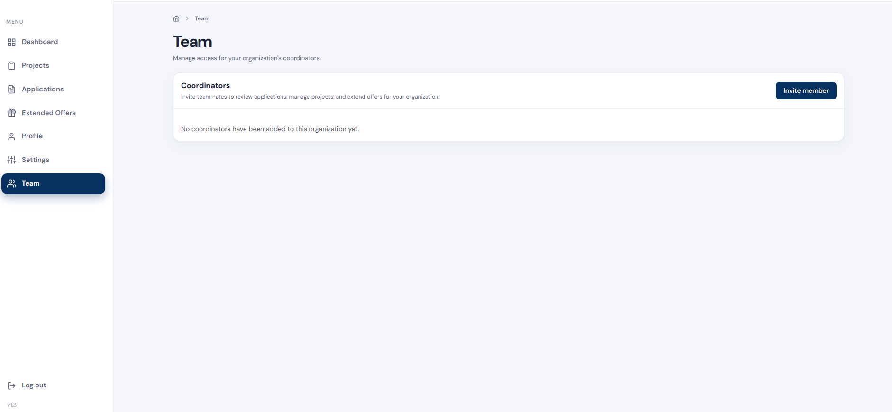
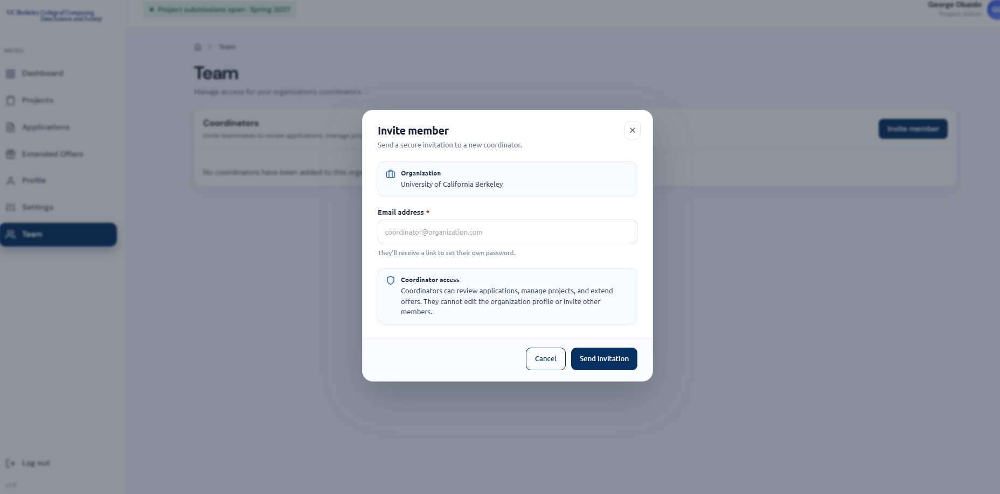

Project coordinators are teammates from your organization who help you run your Data Discovery projects. Once invited, a coordinator can **review applications**, **manage projects**, and **extend offers** to students on your behalf.

---

## Step 1: Open the Team Page

Once logged in, click **Team** in the left-hand menu. The **Coordinators** panel lists everyone who has access to your organization's account. If you haven't added anyone yet, you'll see *"No coordinators have been added to this organization yet."*

Click **Invite member** in the top-right corner of the panel.

---

## Step 2: Send an Invitation

In the **Invite member** window, check that the **Organization** shown is correct, then enter the coordinator's **email address** and click **Send invitation**.

The coordinator will receive a secure link by email to set their own password, so you never need to share your login details.

> **Coordinator access:** coordinators can review applications, manage projects, and extend offers. They **cannot** edit the organization profile or invite other members, so only you can add new coordinators.

---

## Step 3: Invite Additional Coordinators

Each invitation is sent to **one email address**. If you have more than one coordinator, click **Invite member** again and send a separate invitation to each person. Repeat until everyone on your team has been invited.

> 💡 Ask your coordinators to check their spam or junk folder if the invitation doesn't arrive within a few minutes.

If you have any questions, feel free to contact [cdss-datadiscovery@berkeley.edu](mailto:cdss-datadiscovery@berkeley.edu).
