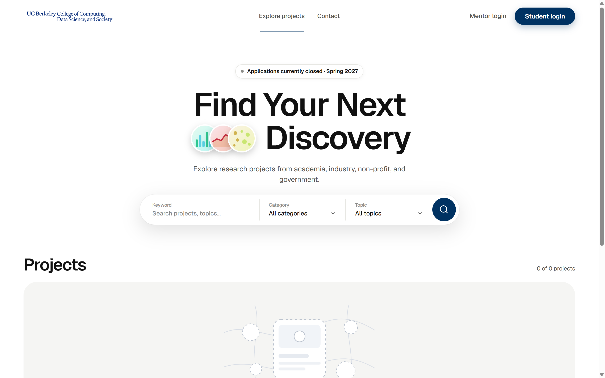
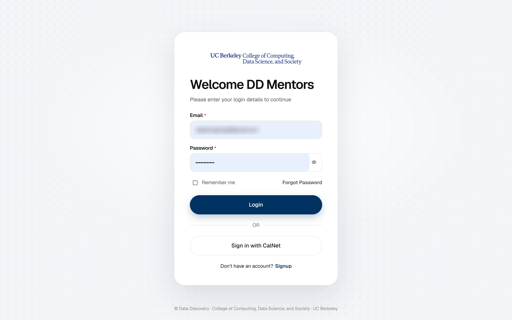
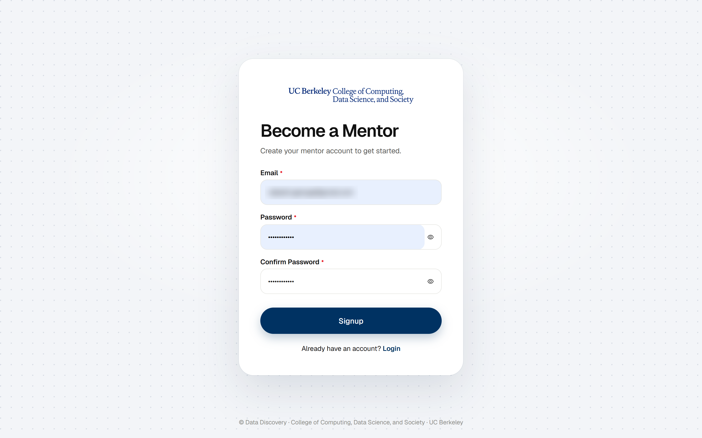
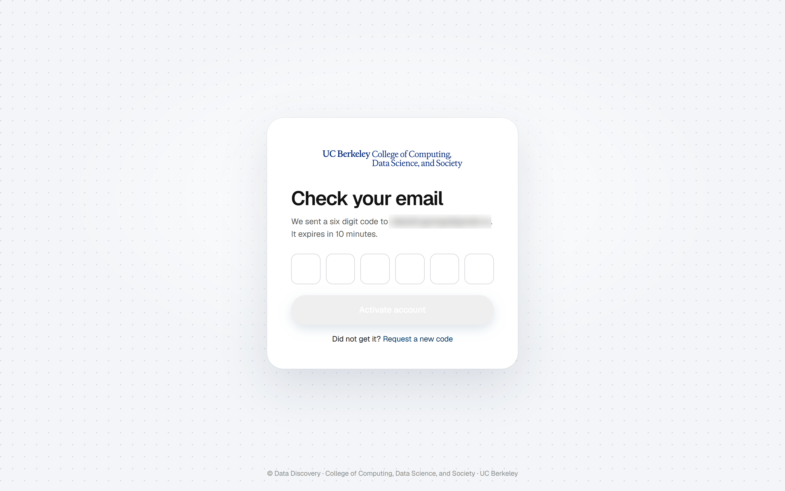
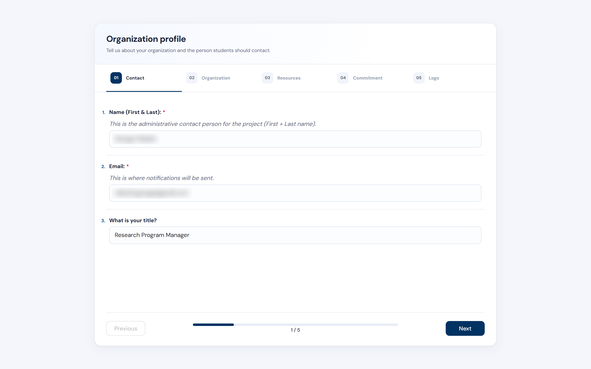
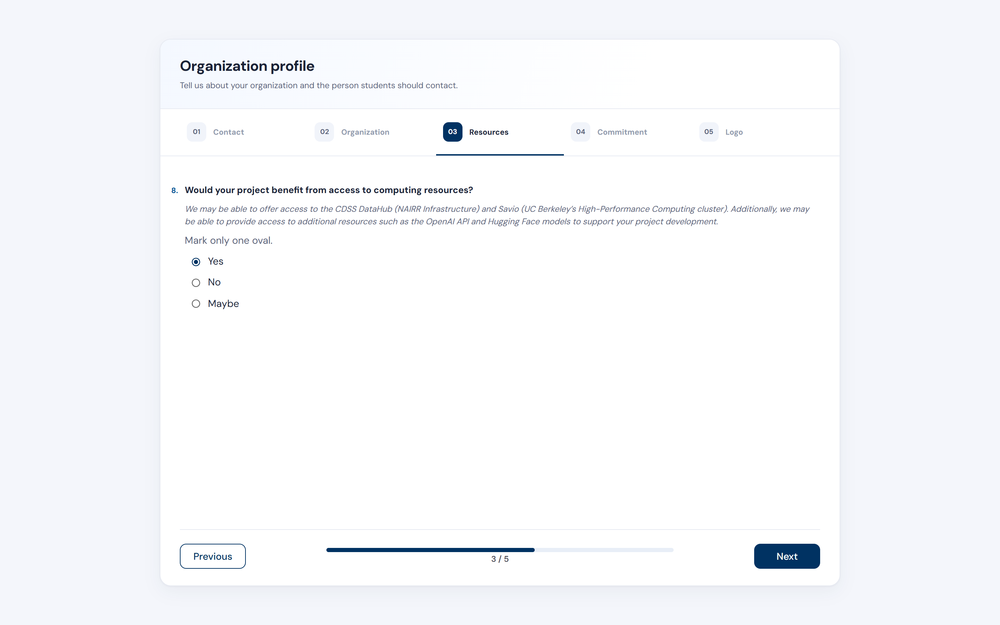
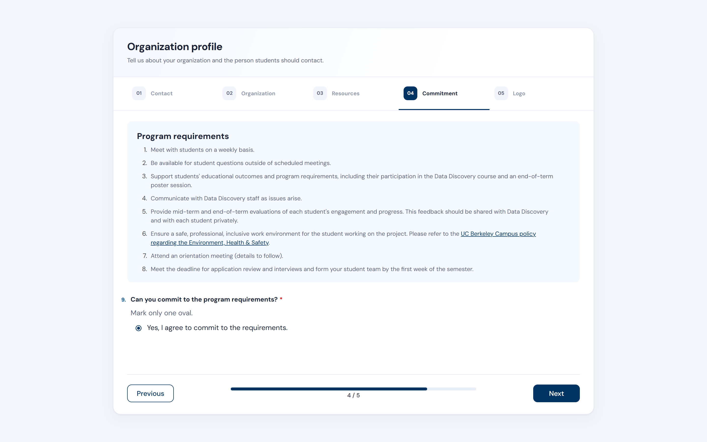
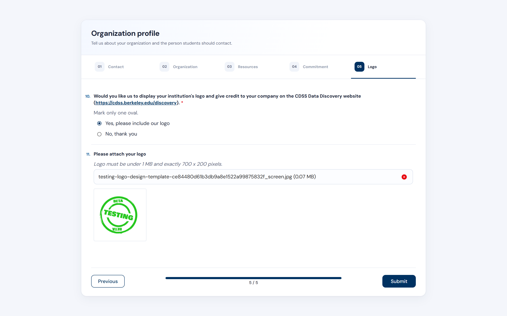
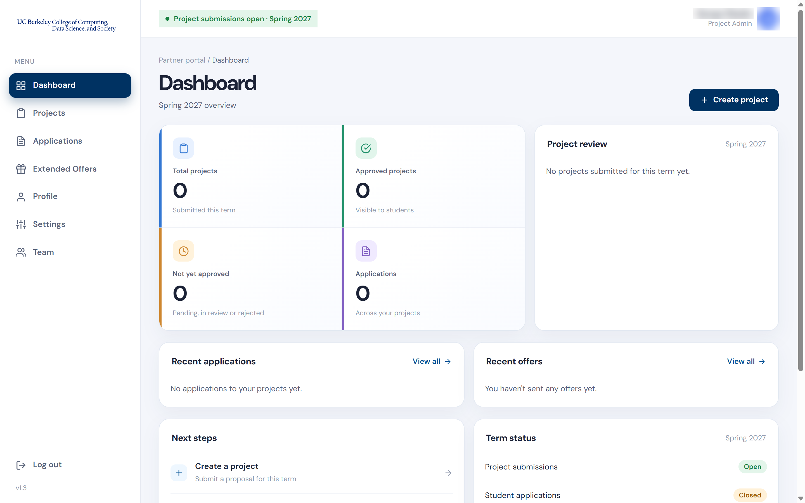

This guide walks new mentors through the account signup process on the DDMatch platform.

## Step 1: Signup

Navigate to the homepage and click **"Mentor login"** in the top-right menu.

> This will redirect you to the mentor login portal where you can either create a new account or log in with your existing credentials.

## Step 2: Click "Signup"

On the **Welcome DD Mentors** login screen, locate the **“Don’t have an account? Signup”** link at the bottom of the form and click it.

> This will redirect you to the **Become a Mentor** registration form where you can create your new account.

> **UC Berkeley affiliates:** if you have a CalNet ID, you can click **"Sign in with CalNet"** on the login screen instead of creating an account with an email and password. CalNet sign-in is only for UC Berkeley faculty, staff, and students; all other mentors should sign up with their email address.

## Step 3: Complete the Signup Form

Enter your email address and choose a secure password that includes at least one lowercase letter, one uppercase letter, one number, and one special character. Confirm your password, then click **"Signup"**.

> Once submitted, you will be prompted to verify your email before gaining access to your mentor dashboard.

## Step 4: Verify Your Email

On the **Check your email** screen, look in your inbox for the six-digit code sent to your registered email address. The code expires in 10 minutes. If you don’t see it, be sure to check your spam or junk folder. Enter the code in the boxes provided, then click **"Activate account"**.

> If you didn’t receive the code, or it expired, click **“Request a new code”** to resend it.

## Step 5: Login to Your Account

Once your account has been verified, return to the **Mentor login** page. Enter your registered email and password, then click **"Login"** to access your dashboard. UC Berkeley affiliates who use CalNet can click **"Sign in with CalNet"** instead.

> You now have full access to your Mentor Dashboard, where you can manage your profile, submit project proposals, and track student applications.

## Step 6: Organization Profile: Contact

Upon first login, you'll be asked to complete your **Organization profile**. The form has five tabs: **Contact**, **Organization**, **Resources**, **Commitment**, and **Logo**. A progress bar at the bottom shows where you are, and you can click **Previous** to go back at any time.

On the **Contact** tab, enter the **name (first and last)** of the administrative contact person for the project, the **email** where notifications should be sent, and **your title**. Click **Next** to continue.

> This is the person students and Data Discovery staff will contact about your project.

## Step 7: Organization Profile: Organization

On the **Organization** tab, fill in your **organization details**, such as its name, website, a short introduction, and the sector your organization belongs to (e.g., Private Industry, Non-Profit). Click **Next** to continue.

> These details will be displayed to students and help match your organization with the right candidates.

## Step 8: Organization Profile: Resources

On the **Resources** tab, you'll be asked whether your project would benefit from access to computing resources. These may include the CDSS DataHub (NAIRR infrastructure), Savio (UC Berkeley's high-performance computing cluster), and additional resources such as the OpenAI API and Hugging Face models.

> Select the most accurate response: **Yes**, **No**, or **Maybe**, then click **Next** to proceed.

## Step 9: Organization Profile: Commitment

On the **Commitment** tab, read the **Program requirements** carefully. Mentors are expected to:

1. Meet with students on a weekly basis.
2. Be available for student questions outside of scheduled meetings.
3. Support students' educational outcomes and program requirements, including their participation in the Data Discovery course and an end-of-term poster session.
4. Communicate with Data Discovery staff as issues arise.
5. Provide mid-term and end-of-term evaluations of each student's engagement and progress, shared with Data Discovery and with each student privately.
6. Ensure a safe, professional, inclusive work environment, in line with UC Berkeley campus policy on Environment, Health & Safety.
7. Attend an orientation meeting.
8. Meet the deadline for application review and interviews, and form your student team by the first week of the semester.

> Select **"Yes, I agree to commit to the requirements."** and click **Next** to proceed.

## Step 10: Organization Profile: Logo & Submit

On the **Logo** tab, choose whether you'd like your institution's logo displayed, with credit to your organization, on the [CDSS Data Discovery website](https://cdss.berkeley.edu/discovery). If you select **"Yes, please include our logo"**, attach your logo file. It must be **under 1 MB and exactly 700 × 200 pixels**. Otherwise, select **"No, thank you"**. Then click **Submit** to complete your profile.

> Your profile is now ready, and you can start using the platform.

## Step 11: Explore the Dashboard

Once onboarded, you'll land on your **Dashboard**, which gives an overview of the current term. From here you can see:

- **Total projects:** projects you've submitted this term
- **Approved projects:** projects visible to students
- **Not yet approved:** projects pending, in review, or rejected
- **Applications:** student applications across your projects

The dashboard also shows the **Project review** status of your submissions, your **Recent applications** and **Recent offers**, suggested **Next steps**, and the **Term status** (whether project submissions and student applications are open). Click **Create project** in the top right to submit a new project.

Use the menu on the left to move between **Dashboard**, **Projects**, **Applications**, **Extended Offers**, **Profile**, **Settings**, and **Team**.

> This is your command center for participating in the Data Discovery program.
