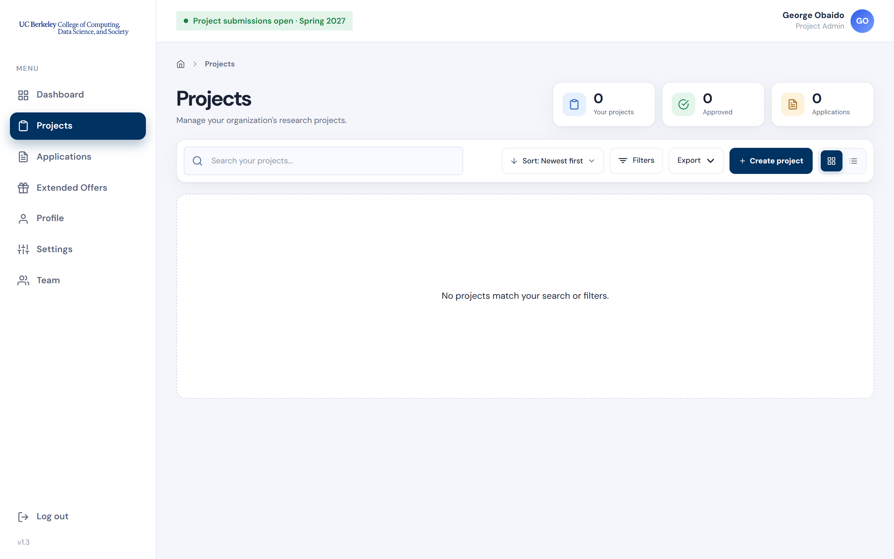
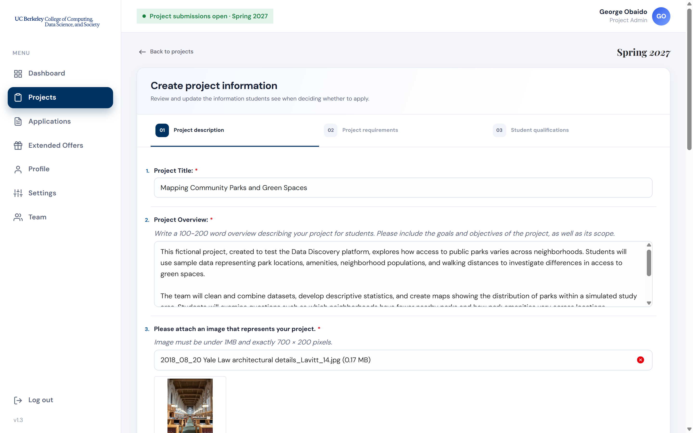
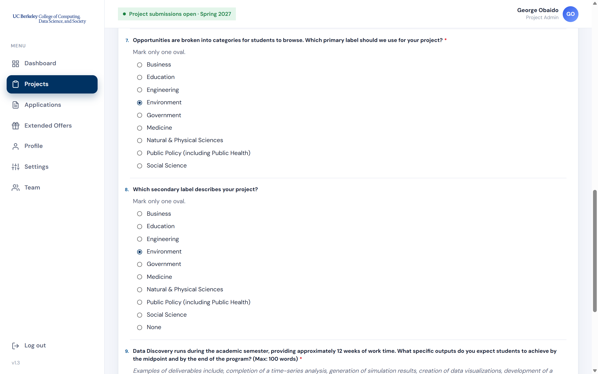
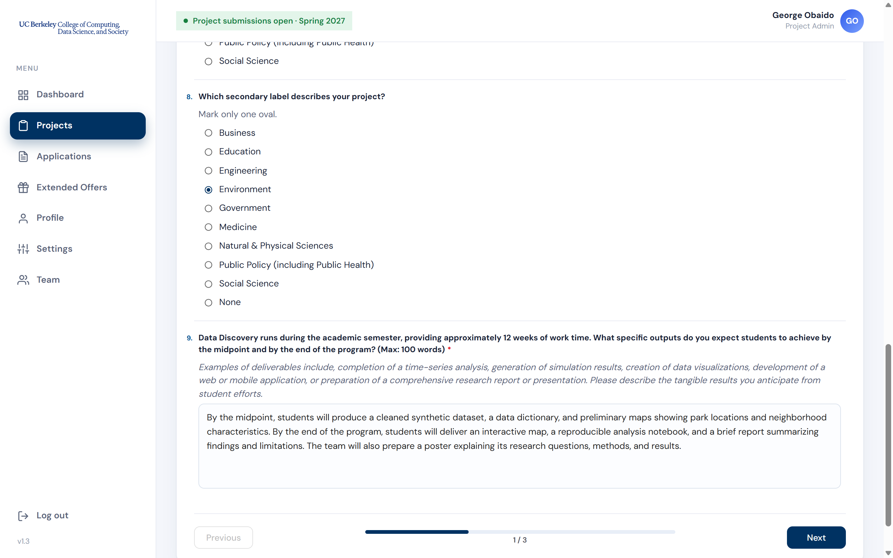
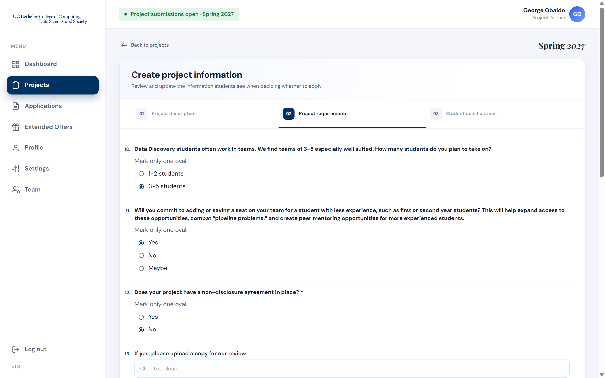
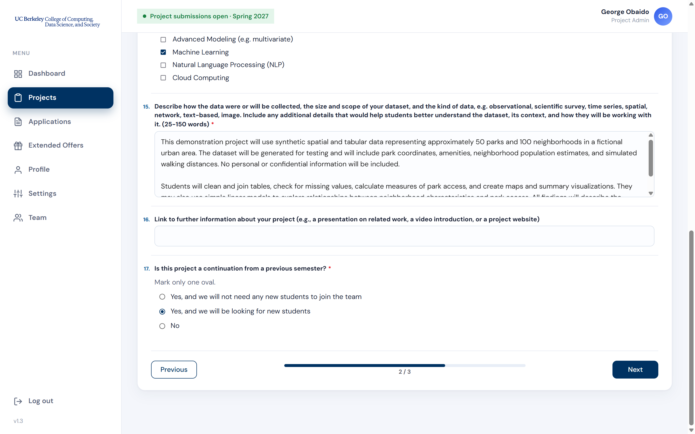
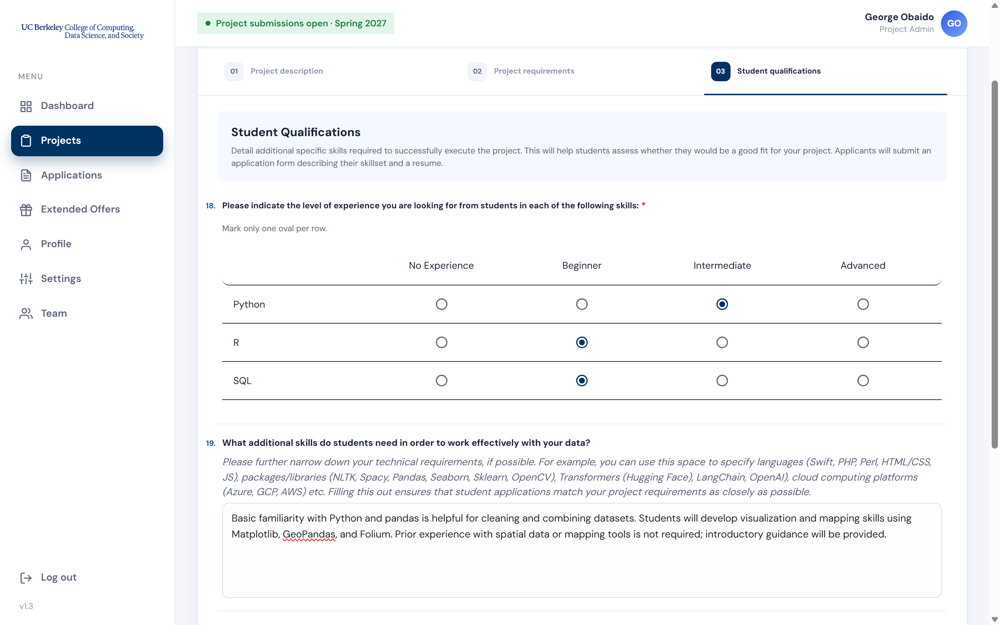
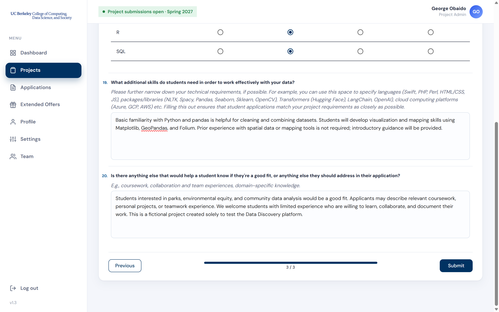
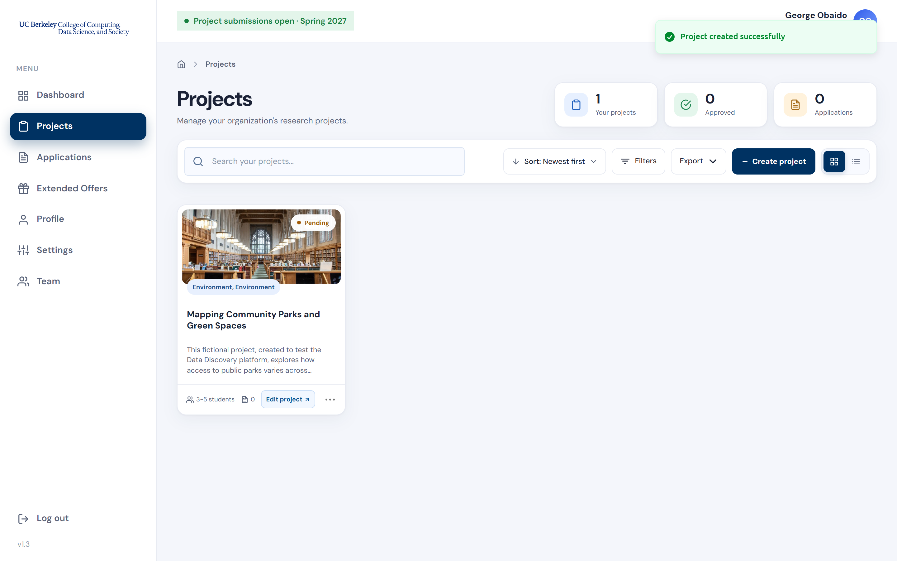

This guide walks mentors through the steps required to successfully submit a project on the DD Match platform.

---

## Step 1: Go to Projects

Once logged in, click **Projects** in the left-hand menu. This page lists your organization's projects, with counts of **Your projects**, **Approved** projects and **Applications** at the top. Click the **+ Create project** button to start a new project.

> The **Create project** form has three tabs: **Project description**, **Project requirements**, and **Student qualifications**. Use **Next** and **Previous** at the bottom of the form to move between them; the progress bar shows how far along you are. Questions marked with a red asterisk (*) are required.

---

## Step 2: Project Description: Title, Overview and Image

On the **Project description** tab, enter your **Project Title** and a **Project Overview** of 100–200 words describing the project for students, including its goals, objectives, and scope. Then attach an image that represents your project. It must be **under 1 MB and exactly 700 × 200 pixels**.

---

## Step 3: Project Description: Categories

Students browse opportunities by category. Choose the **primary label** that best describes your project: Business, Education, Engineering, Environment, Government, Medicine, Natural & Physical Sciences, Public Policy (including Public Health), or Social Science. You can also pick a **secondary label**, or select **None**.

---

## Step 4: Project Description: Deliverables

Data Discovery provides roughly 12 weeks of work time during the semester. Describe the specific outputs you expect students to achieve **by the midpoint and by the end of the program** (up to 100 words), such as a time-series analysis, simulation results, data visualizations, a web or mobile application, or a research report or presentation. Click **Next** to continue.

---

## Step 5: Project Requirements: Team and Agreements

On the **Project requirements** tab, answer the following:

- **Team size:** how many students you plan to take on (**1–2** or **3–5**). Teams of 3–5 are especially well suited.
- **A seat for a less experienced student:** whether you'll add or save a place on your team for a first- or second-year student (**Yes**, **No**, or **Maybe**). This helps expand access to these opportunities and creates peer mentoring for more experienced students.
- **Non-disclosure agreement:** whether your project has an NDA in place. If it does, upload a copy for the program team to review.

---

## Step 6: Project Requirements: Skills, Data and Continuation

Still on the **Project requirements** tab:

- **Skills:** check the data science skills your project involves (e.g., Machine Learning, Natural Language Processing, Advanced Modeling, Cloud Computing).
- **Dataset:** describe how the data were or will be collected, the size and scope of the dataset, and the kind of data (e.g., observational, survey, time series, spatial, network, text, image), in 25–150 words. Include anything that would help students understand the data and how they'll work with it.
- **Further information:** optionally, link to a presentation, video introduction, or project website.
- **Continuation:** say whether this project continues from a previous semester: **Yes, and we will not need any new students**, **Yes, and we will be looking for new students**, or **No**.

Click **Next** to continue.

---

## Step 7: Student Qualifications: Experience Levels

On the **Student qualifications** tab, describe the skills students need, so applicants can judge whether they're a good fit. (Applicants submit an application form describing their skill set, along with a resume.)

First, indicate the level of experience you're looking for in **Python**, **R**, and **SQL**: **No Experience**, **Beginner**, **Intermediate**, or **Advanced**.

---

## Step 8: Student Qualifications: Additional Skills, then Submit

Narrow down any other technical requirements, such as languages (e.g., Swift, PHP, HTML/CSS, JS), packages and libraries (e.g., Pandas, Scikit-learn, Hugging Face Transformers, LangChain, OpenAI), or cloud platforms (Azure, GCP, AWS). Then add anything else that would help students know if they're a good fit, such as relevant coursework, teamwork experience, or domain knowledge.

When you're done, click **Submit**.

---

## Step 9: Track Your Project

You'll see **Project created successfully**, and your project appears on the **Projects** page with a **Pending** status while the Data Discovery Program Team reviews it. Each project card shows its categories, team size, and number of applications. Click **Edit project** to make changes.

> ✅ Congratulations! Your project has been successfully submitted for consideration and will undergo review by the Data Discovery Program Team. Please await further communication regarding the status of your submission.
>
> Once approved, your project will appear in the student-facing portal, where eligible students can apply to join your team. In the meantime, you may return to your dashboard to monitor progress, update project details, or manage your profile.
>
> If you have any questions, feel free to contact cdss-datadiscovery@berkeley.edu.
